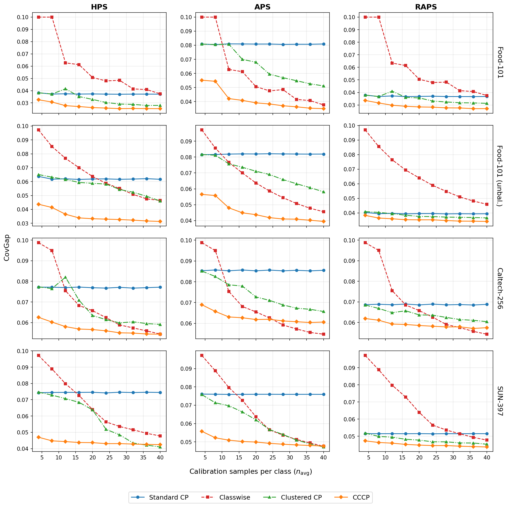

# Cross-Fitted Clustered Conformal Prediction (CFCP)

This repository contains the code for reproducing the experiments in:

> **Cross-Fitted Clustered Conformal Prediction**

## Overview

In classification with many classes, **classwise conformal prediction** calibrates a separate threshold per class to guarantee class-conditional coverage, but requires many calibration examples per class.
**Clustered conformal prediction** pools similar classes into clusters to share calibration data, but must split its calibration budget between learning the clusters and computing thresholds.

**CFCP** eliminates this trade-off by learning the clusters from cross-fitted *training* scores, leaving the *entire* calibration set for threshold estimation. The cross-fitted subfold models are then reused as an **ensemble predictor (EnsCFCP)**, improving accuracy and reducing prediction-set size at no additional training cost.

<p align="center">
  
</p>

## Key Results

At target coverage $1-\alpha = 0.90$ with HPS scores and $n_\text{cal}/C = 30$ calibration samples per class:

| Dataset | Method | CovGap | AvgSize | Top-1 (%) |
|---------|--------|--------|---------|-----------|
| Food-101 | Standard | .037 | 7.0 | 60.7 |
| Food-101 | CFCP | **.026** | 7.7 | 60.7 |
| Food-101 | EnsCFCP (K=10) | **.026** | **5.1** | **65.8** |
| Caltech-256 | Standard | .077 | 2.1 | 78.3 |
| Caltech-256 | CFCP | **.055** | 3.5 | 78.3 |
| Caltech-256 | EnsCFCP (K=10) | **.056** | **2.5** | **81.5** |
| SUN-397 | Standard | .075 | 10.5 | 52.7 |
| SUN-397 | CFCP | **.043** | 15.4 | 52.7 |
| SUN-397 | EnsCFCP (K=10) | **.045** | **8.3** | **57.5** |

- **CFCP** achieves the lowest CovGap (mean absolute per-class coverage deviation) across all datasets
- **EnsCFCP** reduces prediction-set size by up to 34% (Food-101: 7.7 to 5.1) while maintaining coverage, by reusing the cross-fitted models as an ensemble

## Method

### CFCP

1. **Train** the prediction model $f$ on the training set
2. **Cross-fit**: partition the training set into $K$ folds; for each fold, train a subfold model on the remaining $K-1$ folds and compute nonconformity scores on the held-out fold
3. **Cluster**: use the pooled cross-fitted scores to build quantile embeddings and group the $C$ classes into $M$ clusters via weighted $k$-means
4. **Calibrate**: compute one threshold per cluster using the *entire* calibration set (scored by the prediction model $f$)
5. **Predict**: include class $y$ if $s(x,y) \leq \hat{q}_{\hat{h}(y)}$

### EnsCFCP

The $K$ subfold models from step 2 are repurposed as an ensemble at test time. The ensemble's improved accuracy produces lower nonconformity scores for the true class, yielding tighter prediction sets with the same coverage guarantee.

## Installation

```bash
pip install -r requirements.txt
```

### Dependencies

- Python >= 3.10
- PyTorch >= 2.0
- torchvision
- scikit-learn
- numpy
- matplotlib
- pyarrow (for SUN-397 download only)

## Datasets

The experiments use three publicly available image classification datasets:

| Dataset | Classes | Images |
|---------|---------|--------|
| [Food-101](https://data.vision.ee.ethz.ch/cvl/datasets_extra/food-101/) | 101 | 101,000 |
| [Caltech-256](https://data.vision.ee.ethz.ch/cvl/datasets/caltech-256/) | 257 | 30,607 |
| [SUN-397](https://vision.princeton.edu/projects/2010/SUN/) | 397 | 108,754 |

We also construct a controlled **unbalanced variant** of Food-101 by subsampling classes to create frequency imbalance.

Download each dataset and place it under `data/`. See `data/README.md` for the expected directory structure.

## Reproducing Experiments

### 1. Download datasets

```bash
# Download individual datasets
python prepare_data.py --dataset food101
python prepare_data.py --dataset caltech256
python prepare_data.py --dataset sun397    # requires pyarrow

# Or download all at once
python prepare_data.py --all
```

This downloads each dataset into `data/` and builds a 224×224 uint8 image cache (`.npy`) for fast loading.

### 2. Run experiments

```bash
# Run CFCP on Food-101 with K=10 folds (20 iterations, all score functions)
python run_experiment.py --dataset food101 --K 10

# Run on unbalanced Food-101
python run_experiment.py --dataset food101_unbal --K 10

# Run on Caltech-256 with K=3 folds
python run_experiment.py --dataset caltech256 --K 3

# Custom settings
python run_experiment.py --dataset sun397 --K 5 --n-iters 10 --train-size 10000
```

Results are saved as 4D arrays in `results/{dataset}/{dataset}_{K}F_{score}.pkl` with shape `(6 methods × 19 navgs × N_iters × 15 metrics)`.

### 3. Generate figures

```bash
# Regenerate all figures from the pre-computed results
python plot_figures.py

# Single dataset / K / score
python plot_figures.py --dataset food101 --K 10 --score HPS

# Only the multi-dataset grid figure
python plot_figures.py --grid-only
```

## Project Structure

```
.
├── README.md
├── LICENSE
├── CITATION.cff
├── requirements.txt
├── index.html               # GitHub Pages project page
├── prepare_data.py          # Download datasets and build image caches
├── methods.py               # CP methods, model training, scoring, APS/RAPS
├── run_experiment.py        # Experiment loop and CLI
├── plot_figures.py          # Generate figures from result arrays
├── data/                    # Datasets (created by prepare_data.py)
├── results/                 # Pre-computed 20-iteration result arrays
│   ├── food101/
│   ├── food101_unbal/
│   ├── caltech256/
│   └── sun397/
│       ├── {dataset}_{K}F_HPS.pkl
│       ├── {dataset}_{K}F_APS.pkl
│       └── {dataset}_{K}F_RAPS.pkl
└── figures/                 # Plots (covgap, boxplots, frequency, etc.)
    ├── covgap_vs_navg_grid.png
    ├── {dataset}_ft_covgap_vs_navg_dense*.png
    ├── {dataset}_ft_boxplot_navg*.png
    └── ...
```

## Citation

```bibtex
@article{liang2026cccp,
  title   = {Cross-Fitted Clustered Conformal Prediction},
  author  = {Liang, Tian and Fei, Zhe},
  year    = {2026}
}
```

## License

MIT License
